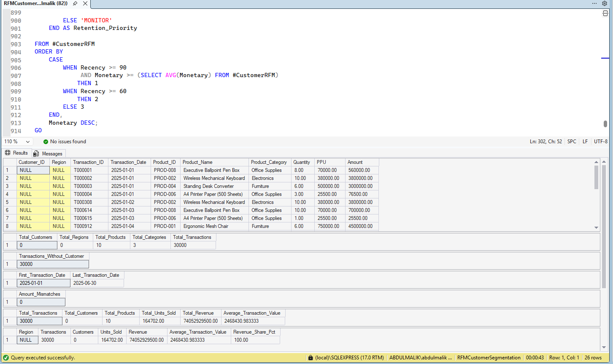

# RFM Customer Segmentation & Customer Value Analysis

## Project Overview



This project uses **Microsoft SQL Server** to analyze transaction-level sales data and identify meaningful customer segments using **RFM analysis**.

The analysis transforms raw transaction data into actionable business insights around:

- Customer value
- Purchase behavior
- Customer loyalty
- Customer retention
- At-risk customers
- Product performance
- Regional performance
- Revenue concentration

The ultimate goal is to help a business understand **which customers matter most, which customers are at risk, and where retention and marketing efforts should be prioritized.**

---

## Business Problem

A business has a large volume of transaction data but needs a clearer understanding of its customer base.

The key business questions are:

- Who are the highest-value customers?
- Which customers purchase most frequently?
- Which customers have not purchased recently?
- Which high-value customers are at risk of being lost?
- Which customer segments generate the most revenue?
- Which products and categories perform best?
- Which regions generate the strongest revenue?
- Where should customer retention efforts be focused?

---

## Analytical Approach

The project follows a complete SQL analytics workflow:

**Raw Transaction Data → Data Quality → Exploratory Analysis → Sales KPIs → Customer Analysis → RFM Analysis → Customer Segmentation → Retention Prioritization → Business Recommendations**

### RFM Framework

**Recency**

How recently a customer made a purchase.

**Frequency**

How frequently a customer makes purchases.

**Monetary**

How much revenue a customer generates.

These dimensions are combined to identify actionable customer segments.

---

## Customer Segments

The analysis produces eight practical customer segments:

| Segment | Business Meaning |
|---|---|
| **Champions** | Recent, frequent and high-value customers |
| **Loyal Low-Value** | Frequent customers with lower monetary value |
| **Potential High-Value** | Customers with high monetary value but lower frequency |
| **New / Developing** | Recently active customers with lower engagement |
| **At-Risk High-Value** | Valuable customers showing signs of inactivity |
| **At-Risk Loyal** | Previously loyal customers becoming inactive |
| **High-Value Win-Back** | Valuable customers requiring reactivation |
| **Low-Value Inactive** | Lower-value customers with limited recent activity |

---

## Key SQL Analysis

The project demonstrates practical SQL Server skills including:

- Data-quality validation
- Duplicate detection
- NULL analysis
- Date validation
- Revenue validation
- Sales KPI analysis
- Regional analysis
- Product analysis
- Monthly trend analysis
- Customer revenue ranking
- RFM metric calculation
- Quintile scoring
- Customer segmentation
- Revenue concentration
- Retention prioritization
- Window functions
- CTEs
- `CASE`
- `RANK`
- `NTILE`
- `PERCENTILE_CONT`
- Running totals

---

## Business Insights

The analysis is designed to uncover several important business insights.

### 1. Customer Value

Revenue is not necessarily distributed evenly across customers.

Identifying the highest-value customers allows the business to protect its most important revenue relationships.

### 2. Customer Retention

High-value customers with increasing recency represent a significant retention opportunity.

Instead of treating every inactive customer equally, the business can prioritize customers according to their historical value.

### 3. Customer Segmentation

Different customer groups require different strategies.

A Champion should not receive the same campaign as a Low-Value Inactive customer.

### 4. Product Performance

Revenue and unit analysis identifies the products and categories that contribute most strongly to business performance.

### 5. Regional Performance

Regional revenue and customer-value analysis helps identify stronger markets and areas that may require additional attention.

---

## Business Recommendations

### Protect Champions

- Reward loyalty
- Offer VIP treatment
- Provide early access
- Encourage referrals
- Use personalized recommendations

### Increase Loyal Customer Value

For Loyal Low-Value customers:

- Introduce bundles
- Encourage cross-selling
- Increase average basket size
- Recommend complementary products

### Develop Potential High-Value Customers

Focus on increasing purchase frequency through:

- Personalized offers
- Product recommendations
- Repeat-purchase campaigns

### Win Back High-Value Customers

At-Risk High-Value and High-Value Win-Back customers should receive priority retention campaigns.

Recommended actions include:

- Personalized win-back offers
- Targeted communication
- Relevant product recommendations
- Time-sensitive incentives

### Reactivate Low-Value Inactive Customers

Use lower-cost automated campaigns rather than expensive high-touch retention strategies.

---

## Technical Setup

The analysis assumes the database has already been created and the source data has already been imported.

### Database

```sql
RFMCustomerSegmentation
```

### Table

```sql
dbo.RFM_Staging
```

The SQL project does **not** create the database, create the table, or import the dataset.

The analysis works directly from the imported staging table.

---

## Project Structure

```text
rfm-customer-segmentation-sql-server/
│
├── RFM_Customer_Segmentation_SQL_Server.sql
│
└── README.md
```

---

## Project Outcome

This project demonstrates how SQL Server can be used to move beyond simple reporting and turn transaction data into **customer-level business intelligence**.

The final output provides a framework for answering:

> **Who are our most valuable customers, who are we at risk of losing, and what should the business do about it?**

The result is an actionable customer segmentation and retention analysis suitable for real-world data analyst workflows.
